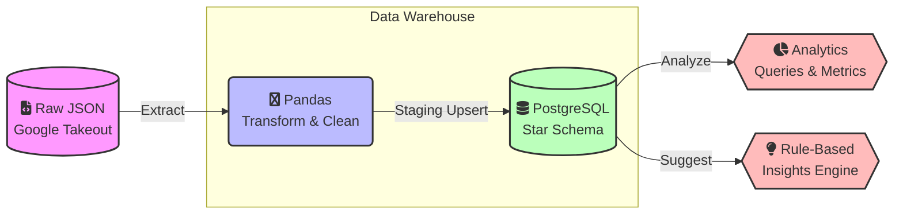

# 📺 YouTube Productivity Analyzer Pipeline


An automated, end-to-end **Batch ETL Pipeline** that extracts YouTube watch history (Google Takeout JSON), cleans and enriches it using Pandas, and loads it into a PostgreSQL data warehouse to surface behavioral insights (peak hours, productivity ratios, and binge-watching patterns).

---

## 🏗️ Engineering Highlights

This project was built with production-grade data engineering principles in mind:
- **Idempotent Incremental Loading:** Uses a staging-table pattern and `ON CONFLICT DO NOTHING` upsert semantics, allowing the pipeline to safely re-run on full-extract JSON files without data duplication.
- **Data Integrity & Modeling:** Modeled as a **Star Schema** enforcing 28 distinct data integrity constraints (NOT NULL, CHECK, UNIQUE, FK) to eliminate downstream quality issues.
- **Feature Engineering:** Derived 9 analytical dimensions from 7 messy raw JSON fields (timestamp decomposition, binge-session assignment, 100% coverage productivity classification).
- **Automated Insight Generation:** Designed 6 analytical SQL queries leveraging advanced features like `FILTER`, window functions, and `STRING_AGG` to replace manual Excel workflows.

---

## 🏛️ Architecture Workflow



All stages are orchestrated as a DAG using **Apache Airflow**, but can also be run as a standalone Python pipeline for local development.

---

## 🚀 1. Getting your real data

> [!TIP]
> **No data yet? No problem!** 
> You can run `python src/generate_sample_data.py` to create a realistic synthetic `watch-history.json` and test the pipeline immediately.

To use your own data, Google Takeout lets you export your actual YouTube watch history:
1. Go to `takeout.google.com`
2. Select **YouTube and YouTube Music**
3. Export as **JSON**
4. Drop the resulting `watch-history.json` file into `data/watch-history.json`.

---

## ⚙️ 2. Local Setup (No Airflow)

```bash
cd youtube_productivity_pipeline
python -m venv venv
source venv/bin/activate          # Windows: venv\Scripts\activate
pip install -r requirements.txt

cp .env.example .env               # Edit .env with your Postgres credentials
```

Create the database and schema:

```bash
createdb youtube_analytics
psql youtube_analytics -f sql/schema.sql
```

Run the standalone pipeline:
```bash
# Extract -> Enrich -> Transform -> Load -> Analyze -> Suggest
python -m src.etl.pipeline
```

---

## 🌬️ 3. Run it with Airflow

```bash
export AIRFLOW_HOME=$(pwd)/airflow_home
airflow db init
airflow users create --username admin --password admin --firstname A --lastname D --role Admin --email admin@example.com

# Link Airflow to this project's dags/ folder
mkdir -p $AIRFLOW_HOME/dags
ln -s $(pwd)/dags/youtube_productivity_dag.py $AIRFLOW_HOME/dags/

airflow webserver -p 8080 &
airflow scheduler &
```

> [!NOTE]
> Open `http://localhost:8080` in your browser, un-pause the `youtube_productivity_pipeline` DAG, and trigger it. It will run daily (`@daily`) by default.

---

## 📊 4. Key Metrics Produced

| Metric | Query Name | Description |
|---|---|---|
| **Peak usage hour** | `peak_usage_hour` | Hour-of-day (0-23) with most watch events |
| **Productivity ratio** | `productivity_ratio` | % of watch time in "productive" category, by day |
| **Weekday trend** | `weekday_trend` | Total watch time by day of week |
| **Binge sessions** | `binge_sessions` | Sequences of 3+ videos watched with <10 min gaps |
| **Top channels** | `top_channels` | Most-watched channels by total watch count |

*(All queries live in `sql/analysis_queries.sql` and are executed from `src/analysis/report.py`)*

---

## 🧠 5. Suggestion Engine (Rule-Based Insights)

`src/analysis/suggestions.py` reads query results and applies independent rules. There is no ML involved; every suggestion is 100% explainable by the numbers.

| Rule | Fires when... |
|---|---|
| `low_overall_productivity` | All-time productive-content share is below 25% |
| `late_night_peak_usage` | Peak usage hour falls in a late-night window (21:00-02:00) |
| `binge_session_detected` | A session has 5+ videos back-to-back |
| `weekend_activity_gap` | Weekend watch time is under 20% of total |
| `productivity_trend_declining` | Last-7-day avg productive % drops 10+ points vs. prior 7 days |

*(Suggestions are persisted to an append-only `insights_suggestions` log in PostgreSQL so you can track behavioral changes over time).*
