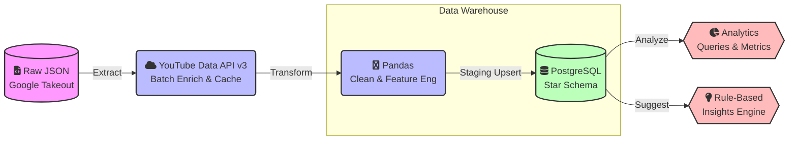

# 🦉 WatchWise — YouTube Productivity & Habit Analytics


**WatchWise** is an automated, end-to-end **Batch ETL Data Pipeline** that transforms raw YouTube watch history into actionable productivity analytics. It enriches raw export logs with official metadata from the **YouTube Data API v3** (accurate ISO-8601 durations & categories), models the data into a **PostgreSQL Star Schema**, and surfaces deep behavioral patterns (peak hours, productive vs. distracting ratios, binge-watching streaks, and weekday trends).

---

## ⚡ Engineering Highlights

- **External API Metadata Enrichment:** Integrates Google's **YouTube Data API v3** to replace rough time estimates with exact video durations and official category classifications. Employs 50-item batching, persistent JSON caching, and graceful offline fallback.
- **Idempotent Incremental Loading:** Implements a staging-table pattern with `ON CONFLICT DO NOTHING` upsert semantics, ensuring safe, duplicate-free re-runs on periodic full-export Takeout files.
- **Production Star Schema:** Modeled with 28 distinct relational integrity constraints (NOT NULL, CHECK, UNIQUE, Foreign Keys) across dimension and fact tables.
- **Robust Feature Engineering:** Derives 9 analytical dimensions from messy raw JSON fields (timestamp decomposition, binge-session assignment, keyword + API hybrid productivity classification).
- **Automated Insights & Suggestions:** 6 analytical SQL queries leveraging window functions, `FILTER`, and `STRING_AGG`, backed by a rule-based suggestion engine tracking behavioral changes over time.
- **Comprehensive Test Suite:** 35 unit and integration tests covering extraction, API batching, caching, transformations, and error handling.

---

## 🏗️ Architecture Workflow



All stages are orchestrated as a DAG using **Apache Airflow**, but can also be executed standalone via Python for local development and testing.

---

## 📥 1. Getting Your Data

> [!TIP]
> **No data yet? No problem!** 
> Run `python src/generate_sample_data.py` to create a realistic synthetic `watch-history.json` and test the pipeline immediately.

To use your real data from Google Takeout:
1. Go to [takeout.google.com](https://takeout.google.com)
2. Select **YouTube and YouTube Music**
3. Choose **JSON** as the export format
4. Place the resulting `watch-history.json` file in `data/watch-history.json`.

---

## 🚀 2. Local Setup (Standalone Pipeline)

```bash
# Clone and enter the repository
git clone https://github.com/RaviShinde19/watchwise.git
cd watchwise

# Set up virtual environment
python -m venv venv
source venv/bin/activate          # Windows: .\venv\Scripts\activate
pip install -r requirements.txt

# Configure environment variables
cp .env.example .env               # Fill in PostgreSQL credentials & optional YouTube API key
```

Create the database and schema:

```bash
createdb youtube_analytics
psql youtube_analytics -f sql/schema.sql
```

Run the pipeline:
```bash
# Extract -> Enrich (API) -> Transform -> Load -> Analyze -> Suggest
python -m src.etl.pipeline
```

Run the test suite:
```bash
python -m pytest
```

---

## ⏰ 3. Orchestration with Apache Airflow

```bash
export AIRFLOW_HOME=$(pwd)/airflow_home
airflow db init
airflow users create --username admin --password admin --firstname A --lastname D --role Admin --email admin@example.com

# Link DAG folder
mkdir -p $AIRFLOW_HOME/dags
ln -s $(pwd)/dags/youtube_productivity_dag.py $AIRFLOW_HOME/dags/

airflow webserver -p 8080 &
airflow scheduler &
```

> [!NOTE]
> Open `http://localhost:8080` in your browser, unpause the `watchwise_pipeline` DAG, and trigger it. It runs daily (`@daily`) by default.

---

## 📊 4. Key Metrics Produced

| Metric | Query Name | Description |
|---|---|---|
| **Peak usage hour** | `peak_usage_hour` | Hour-of-day (0-23) with most watch events |
| **Productivity ratio** | `productivity_ratio` | % of watch time in "productive" category, by day |
| **Weekday trend** | `weekday_trend` | Total watch time by day of week |
| **Binge sessions** | `binge_sessions` | Sequences of 3+ videos watched with <10 min gaps |
| **Top channels** | `top_channels` | Most-watched channels by total watch count |

*(Queries are defined in `sql/analysis_queries.sql` and executed via `src/analysis/report.py`)*

---

## 💡 5. Insight & Suggestion Engine

`src/analysis/suggestions.py` evaluates query results against explainable productivity rules:

| Rule | Fires when... |
|---|---|
| `low_overall_productivity` | All-time productive-content share is below 25% |
| `late_night_peak_usage` | Peak usage hour falls in a late-night window (21:00-02:00) |
| `binge_session_detected` | A session has 5+ videos watched back-to-back |
| `weekend_activity_gap` | Weekend watch time is under 20% of total |
| `productivity_trend_declining` | Last-7-day avg productive % drops 10+ points vs. prior 7 days |

Suggestions are persisted to an append-only `insights_suggestions` table in PostgreSQL to track behavioral improvements over time.